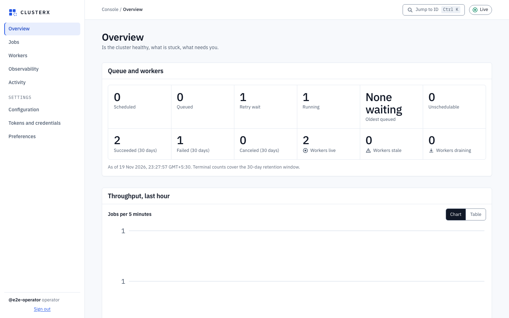
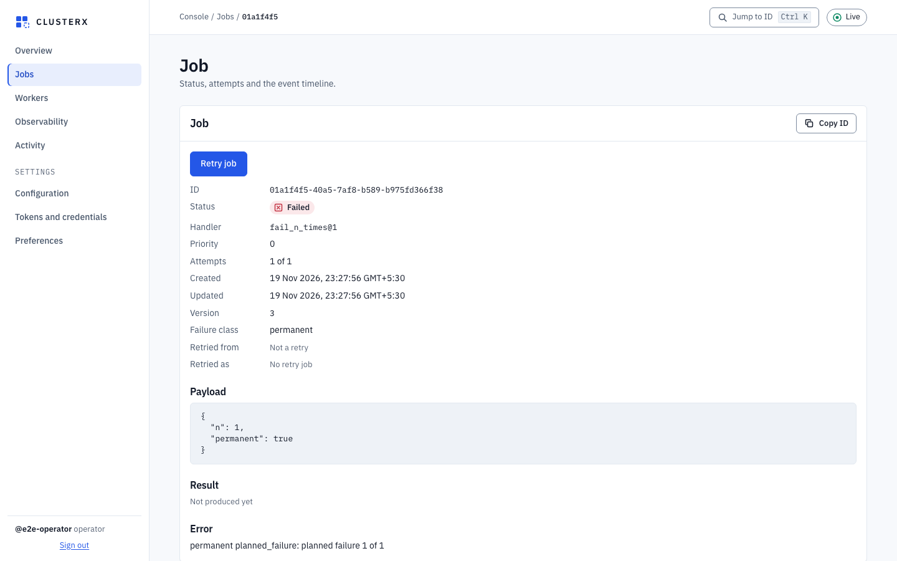

# CLUSTERX

A self-hostable, single-organization distributed background-job platform: a Go control plane on PostgreSQL,
independent pull-based Go workers, an operator console and a public documentation site.

**Status: pre-1.0, not released.** Built milestone by milestone against `docs/product/MASTER_PROMPT.md` (R2).
See [`docs/product/traceability.md`](docs/product/traceability.md) for what is implemented, tested and still open.

<p>
  
  
</p>

Screenshots: console on a local stack with mock OAuth (`docs/design/screenshots/m6/`, captured 2026-11-19 and 2026-11-20).

## What it guarantees — and what it does not

- **At-least-once execution.** A job may run more than once (worker crash, lease expiry). Handlers must be
  idempotent for external side effects. There is **no** exactly-once guarantee.
- **PostgreSQL is the only authority.** Jobs, attempts, leases and events change in single short transactions;
  a submission is acknowledged (2xx) only after commit.
- **Fencing.** A late result from an expired or superseded attempt is rejected; it cannot overwrite the
  recorded outcome. Fencing protects the database — it cannot un-run a handler that kept going.
- **Cancellation is cooperative.** A hard deadline limits authorization, not a Go handler's physical execution.
- **Single coordinator.** No HA leader election; coordinator downtime pauses scheduling.
- **Priority scheduling** (0–9, 9 highest) among eligible jobs; no strict global FIFO or fairness promise.
- **Bounded data.** 64 KiB payloads, 128 KiB results, bounded logs; history expires per retention settings.
- **The public `/demo` is illustrative fixture data**, never live telemetry.
- **Workflows/DAGs are a separate 1.1 scope** and are not part of 1.0.

## Repository layout

```text
apps/control-plane   Go coordinator: REST /api/v1, worker gRPC, scheduler, stream, migrations
apps/worker          reference worker binary
apps/web             Next.js public site, docs, operator console, BFF, isolated demo
packages/sdk-go      Go worker SDK          packages/proto   gRPC contract + generated Go
packages/sdk-ts      generated TS client    packages/ui      design tokens + components
api/openapi.yaml     REST contract          examples/        example handlers
infra/compose        local starter          infra/production local-verified production example
infra/monitoring     Prometheus config + alert rules
docs/                product, architecture/ADRs, design, security, testing, operations, coordination
```

## Local quickstart (engine)

Verified from a clean clone on Linux arm64 (Ubuntu VM, independent audit). On macOS arm64 with Colima (Docker 29) it was run from a
checkout under `$HOME`, not from an independently audited clean clone. amd64 is **not yet verified**.
With Colima, keep the checkout under `$HOME` — Colima mounts only `$HOME` into its VM.

```bash
cp .env.example .env   # fill the three empty values, e.g. with: openssl rand -hex 24
./infra/compose/bootstrap.sh
```

This starts PostgreSQL 18.7, runs migrations, starts the control plane on `127.0.0.1:8080` and three workers,
and writes an operator API token to `infra/compose/.secrets.env` (gitignored). Submit a job:

```bash
set -a; . infra/compose/.secrets.env; set +a
curl -s -X POST http://127.0.0.1:8080/api/v1/jobs \
  -H "Authorization: Bearer $CLUSTERX_OPERATOR_TOKEN" -H 'Content-Type: application/json' \
  -H 'Idempotency-Key: first-job' \
  -d '{"handler_name":"hash_sha256","handler_version":1,"payload":{"data":"hello"}}'
```

Stop with `docker compose -f infra/compose/compose.yaml --env-file .env --profile workers down`
(add `-v` to delete the database volume).

The **operator console** needs a GitHub OAuth app and the BFF keys (see
[`docs/operations/deployment.md`](docs/operations/deployment.md)); it is end-to-end tested against a local mock
OAuth server, **not yet against real GitHub**. To try the console locally without GitHub, use the E2E harness
(`CLUSTERX_E2E_PG_DIR=<dir> pnpm --filter web e2e`), which starts Go, PostgreSQL, workers and a mock OAuth server.

## Development

| Area | Commands |
|---|---|
| Go (all modules, needs PostgreSQL 18 for DB tests) | `go vet ./...` and `CLUSTERX_PG_ADMIN_DSN=… go test -race ./...` per module (`go.work` at root) |
| Contract | `pnpm contract:lint`, `pnpm sdk:check` |
| Web | `pnpm --filter web lint typecheck test build`; live E2E: `CLUSTERX_E2E_PG_DIR=<dir> pnpm --filter web e2e` |

Toolchain: Go 1.27.4, PostgreSQL 18.7, Node 26, pnpm 9.15.9 — exact versions in
[`docs/architecture/dependency-matrix.md`](docs/architecture/dependency-matrix.md).

## Documentation

- Architecture and decisions: [`docs/architecture/`](docs/architecture/) (state machine, ADR-0001…0006)
- Security: [`docs/security/`](docs/security/) (threat model, permissions, ASVS mapping) · reporting: [`SECURITY.md`](SECURITY.md)
- Operations: [`docs/operations/`](docs/operations/) · benchmarks: [`docs/testing/benchmarks.md`](docs/testing/benchmarks.md)
  (measured on a 4-vCPU Colima VM — not a reference host)

## License

Apache License 2.0 — see [`LICENSE`](LICENSE).
